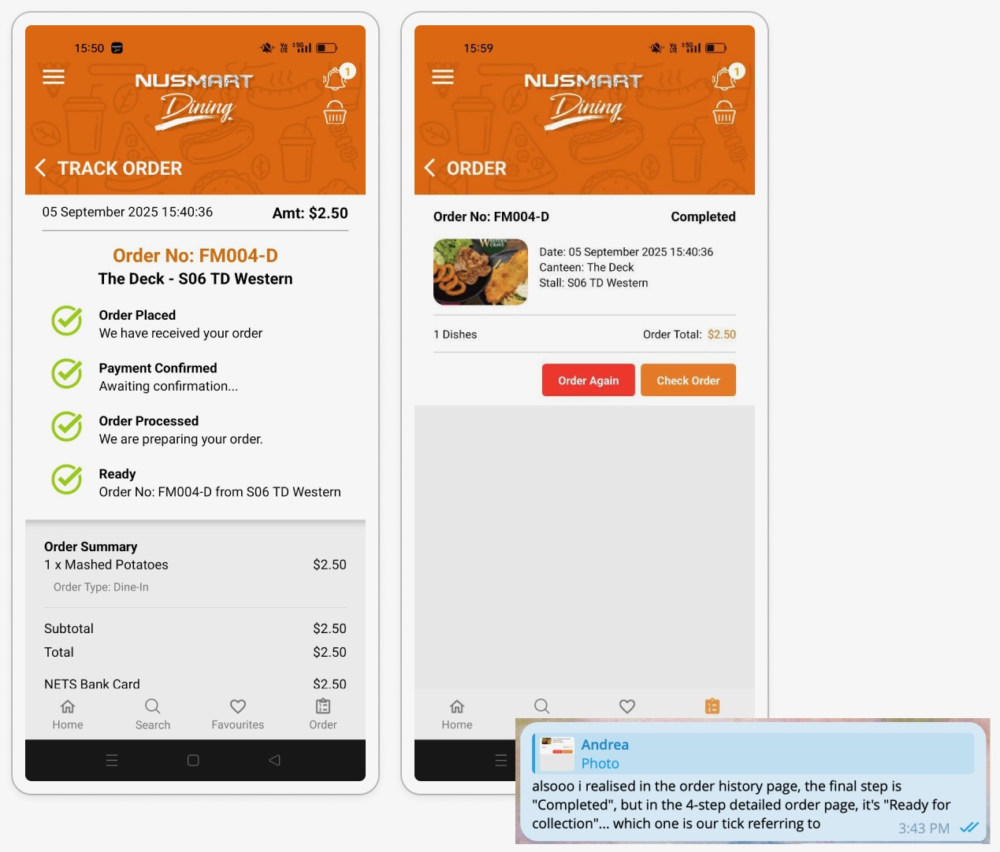
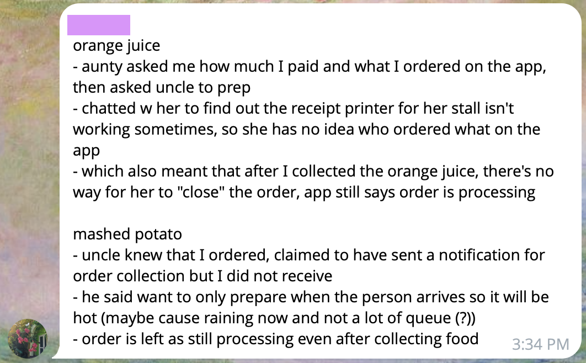

One of my main tasks for the final submission was refining our second persona. The feedback we received was that Taylor "Hassle-Free" Ng overlapped too much with Alex "Chop-Chop" Tan, with both sounding like variations of efficiency-seeking. At first, I assumed this was just a wording issue, but revisiting our contextual inquiry notes forced me to dig deeper. I asked myself "Why?" behind each behaviour. Scanning the canteen from afar, retreating to a seat, and refreshing the app repeatedly---even when TV screens already displayed ready orders---didn't actually align with time-saving. If efficiency were the true goal, Taylor would have relied on the screens or gone straight to the counter. Instead, these behaviours suggested they were trying to delay the moment of approaching the stall, holding out for a clearer signal before entering the physical queue. This showed me that "hassle-free" was only a surface description. The deeper driver was crowd-aversion: a need to minimise the noise, pressure, and uncertainty of navigating a packed canteen. Recognising this distinction sharpened Taylor into a more distinct persona and finally set them apart from Alex.

This mindset of asking "Why" also shaped how we decided where the user journey should end. The current app itself was inconsistent: the Order Details page ended at "Ready," while the Order History page labelled orders as "Completed," which seemed to imply collection. This raised questions---were these two labels referring to the same thing, or not?

{fig-align="center"}

At first, extending the flow to "Collected" felt like the neater, more complete option. But breaking it down showed how messy that would become. Confirming collection would require either users to manually acknowledge it or vendors to input confirmation, both of which introduced burdens and assumptions the system wasn't built for. Even vendors admitted uncertainty about how the app updates orders when we chatted with them. Adding this extra step would complicate the flow without improving the user's visibility of progress.

{fig-align="center"}

We realised that if we tried to account for every real-world step, we would lose clarity and focus. What users really needed was to know when their food was ready---not whether the system could verify they had physically picked it up. In the end, we decided to end the flow at "Ready for Collection," aligning with what the app already presents as the critical endpoint. This choice reinforced an important design lesson for me: good design doesn't mean covering every imaginable scenario---it means defining boundaries around what the system can reliably support, so the user journey stays coherent and purposeful.

Looking back, my biggest learning was that design is less about capturing every detail and more about filtering the right ones. This meant asking why users behaved the way they did, so I could distinguish what really mattered from what was just noise. Once those key insights were clear, the challenge was to present them in a way that felt simple and understandable to users. I've realised that effective design is about distilling complexity into clarity---all while keeping to my scope, so the system remains clear, grounded, and usable.
